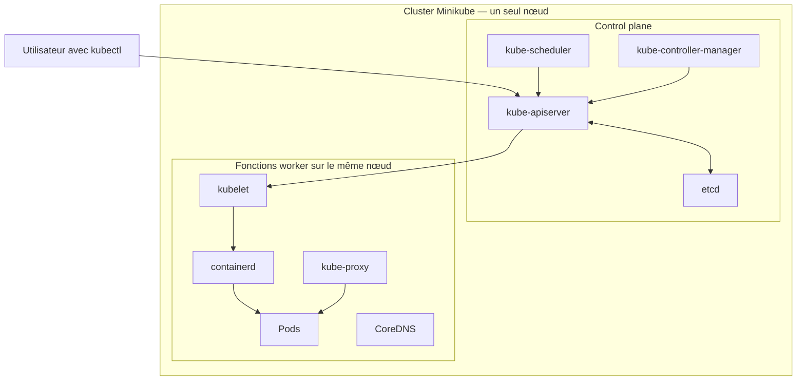

# Compte rendu — TP Kubernetes avec Minikube

## Environnement de travail

- Docker : `24.0.2`
- Minikube : `1.39.0`
- kubectl : `1.37.0`
- Kubernetes : `1.37.0`
- Driver Minikube : Docker
- Réseau CNI : bridge

Le premier démarrage a produit un nœud `NotReady` car le réseau CNI n'était pas initialisé. Le profil Minikube, qui ne contenait encore aucune ressource du TP, a été recréé avec l'option `--cni=bridge`. Après cette correction, le nœud est passé à l'état `Ready`.

## Partie 1 — Explorer l'architecture Kubernetes

### Commandes exécutées

```bash
kubectl get nodes -o wide
kubectl get namespaces
kubectl get pods -A
kubectl get deployments -A
kubectl describe node
kubectl get pods -n kube-system
kubectl get events -A --sort-by=.metadata.creationTimestamp
```

### Observations

- Le cluster contient un seul nœud nommé `minikube`.
- Le nœud est `Ready` et porte le rôle `control-plane`.
- Kubernetes utilise la version `1.37.0`.
- L'adresse interne du nœud est `192.168.49.2`.
- Le nœud exécute Debian 12 dans Docker et utilise `containerd` comme runtime de conteneurs.
- Les quatre namespaces initiaux sont `default`, `kube-node-lease`, `kube-public` et `kube-system`.
- Les composants Kubernetes s'exécutent dans le namespace `kube-system`.
- Le seul Deployment système est `coredns`, avec une réplique disponible.
- Le nœud ne signale aucune pression sur la mémoire, le disque ou le nombre de processus.
- Les événements montrent la création et le démarrage des composants. Ils conservent aussi des avertissements temporaires observés pendant l'initialisation, même lorsque les Pods sont ensuite revenus à l'état `Running`.

### Réponses aux questions

#### 1. Quel est le rôle du control plane ?

Le control plane pilote le cluster. L'API Server reçoit les demandes, `etcd` conserve l'état du cluster, le scheduler choisit le nœud d'exécution des nouveaux Pods et les contrôleurs rapprochent continuellement l'état réel de l'état souhaité.

#### 2. Quelle différence existe-t-il entre un nœud Kubernetes et un Pod ?

Un nœud est une machine de calcul appartenant au cluster. Il fournit du processeur, de la mémoire et un runtime de conteneurs. Un Pod est la plus petite unité déployée par Kubernetes sur un nœud. Il contient un ou plusieurs conteneurs.

#### 3. Quel contrôleur maintient le nombre de réplicas demandé par un Deployment ?

Le Deployment crée et gère un ReplicaSet. Le contrôleur du ReplicaSet maintient ensuite le nombre de Pods demandé.

#### 4. Quelle différence existe-t-il entre un conteneur et un Pod ?

Un conteneur exécute une application isolée à partir d'une image. Un Pod est l'unité gérée par Kubernetes : il peut contenir un ou plusieurs conteneurs qui partagent la même adresse IP, certains volumes et leur cycle de vie.

#### 5. Quelles limites présente un cluster local à un seul nœud par rapport à un cluster de production ?

La panne du nœud arrête tout le cluster et toutes les applications. Ce cluster ne permet pas de tester la répartition entre plusieurs machines ni la tolérance à la panne d'un nœud. Ses ressources, son stockage et son réseau sont également plus simples et plus limités que ceux d'un cluster de production.

### Schéma du cluster local



Dans Minikube, le control plane et les fonctions worker se trouvent sur le même nœud. Le kubelet reçoit les instructions de l'API Server et demande à `containerd` d'exécuter les conteneurs des Pods. Kube-proxy participe au routage réseau et CoreDNS fournit les noms internes au cluster.

## Partie 2 — Déployer une application web

### 2.1 Création du namespace

Le manifeste `k8s/01-namespace.yaml` crée le namespace `tp-k8s`. Après son application, son état est `Active`.

Dans un environnement partagé, un namespace regroupe les ressources d'une équipe, d'un projet ou d'un environnement. Il facilite l'application de droits d'accès et de quotas distincts et permet de supprimer ensemble les ressources concernées.

### 2.2 Création de la ConfigMap

Le manifeste `k8s/02-configmap.yaml` crée la ConfigMap `page-web` dans `tp-k8s`. Elle contient une entrée nommée `index.html` avec la page HTML demandée.

Une ConfigMap sépare la configuration de l'image du conteneur. La page peut ainsi être modifiée sans reconstruire l'image Nginx, et la même image peut être utilisée avec des configurations différentes selon l'environnement.

### 2.3 Création du Deployment

Le manifeste `k8s/03-deployment.yaml` crée le Deployment `web` avec deux répliques Nginx. Le Deployment a créé le ReplicaSet `web-569c7b9764`, qui a lui-même créé deux Pods.

Les deux Pods sont `1/1 Running`, sans redémarrage. Ils ont reçu les adresses internes `10.244.0.5` et `10.244.0.6`. Les deux s'exécutent sur l'unique nœud `minikube`.

Le Deployment définit également :

- une stratégie de mise à jour `RollingUpdate` ;
- des requests et des limits CPU/mémoire ;
- une readiness probe et une liveness probe HTTP ;
- le montage de `index.html` depuis la ConfigMap `page-web`.

### 2.4 Création du Service

Le manifeste `k8s/04-service.yaml` crée le Service `web` de type `ClusterIP`. Il a reçu l'adresse stable interne `10.104.84.172` et expose le port TCP 80.

Son sélecteur `app: web` correspond aux deux Pods. L'EndpointSlice associé contient donc leurs adresses `10.244.0.5` et `10.244.0.6`.

### 2.5 Accès à l'application

La commande suivante transfère le port local 8080 vers le port 80 du Service :

```bash
kubectl port-forward -n tp-k8s service/web 8080:80
```

La requête `curl -i http://localhost:8080` a renvoyé `HTTP/1.1 200 OK`, avec le serveur `nginx/1.30.6` et la page HTML personnalisée.

### Réponses aux questions

#### 1. Quel est le rôle du Deployment par rapport au ReplicaSet ?

Le Deployment gère le déploiement de l'application, les mises à jour progressives et l'historique des révisions. Il crée et pilote des ReplicaSets. Chaque ReplicaSet maintient ensuite le nombre demandé de Pods pour une version donnée.

#### 2. Pourquoi ne pas accéder directement aux adresses IP des Pods ?

Un Pod est éphémère : lorsqu'il est remplacé, son adresse IP peut changer. Un accès direct ne fournit pas non plus une adresse unique pour plusieurs répliques. Le Service donne un point d'accès stable et sélectionne automatiquement les Pods prêts.

#### 3. Quelle différence existe-t-il entre `ClusterIP`, `NodePort` et `LoadBalancer` ?

- `ClusterIP` expose le Service uniquement à l'intérieur du cluster.
- `NodePort` ouvre un port sur chaque nœud pour permettre un accès depuis l'extérieur du cluster.
- `LoadBalancer` demande généralement à l'infrastructure cloud de créer un répartiteur de charge externe devant le Service.

#### 4. Quelle différence existe-t-il entre une readiness probe et une liveness probe ?

La readiness probe détermine si un Pod est prêt à recevoir du trafic. En cas d'échec, il est retiré des destinations du Service sans que son conteneur soit nécessairement redémarré. La liveness probe vérifie si le conteneur fonctionne encore ; après des échecs répétés, le kubelet le redémarre.

#### 5. Que peut-il se passer si une limite mémoire est trop basse ?

Le conteneur peut dépasser la limite et être arrêté avec la raison `OOMKilled`. Kubernetes peut alors le redémarrer. Si le problème se répète, le Pod peut entrer dans un cycle de redémarrages et l'application devenir indisponible.

## Partie 3 — Résilience et auto-rétablissement

### Suppression et remplacement d'un Pod

État initial : deux Pods `web` étaient `1/1 Running`. Le Pod `web-569c7b9764-5khp5` a ensuite été supprimé pendant l'observation avec `kubectl get pods -n tp-k8s -w`.

La séquence observée est la suivante :

1. l'ancien Pod est passé à `Terminating` ;
2. le ReplicaSet a créé `web-569c7b9764-597n6` ;
3. le nouveau Pod est passé par `Pending`, `ContainerCreating` et `Running` ;
4. sa readiness probe a réussi et il est devenu `1/1 Ready` en environ sept secondes.

Le nouveau Pod a reçu l'adresse `10.244.0.7`. Sa description indique `Controlled By: ReplicaSet/web-569c7b9764`. Les événements contiennent `Killing` pour l'ancien Pod et `SuccessfulCreate`, `Scheduled`, `Created` puis `Started` pour le nouveau.

Les logs Nginx montrent un démarrage normal ainsi que les requêtes HTTP des sondes Kubernetes, avec des réponses `200`.

### Réponses aux questions

#### 1. Pourquoi le Pod supprimé est-il remplacé ?

Le Deployment demande deux répliques. Son ReplicaSet détecte qu'il ne reste plus qu'un Pod et en crée un nouveau afin de rétablir l'état souhaité.

#### 2. Quelle différence existe-t-il entre la suppression d'un Pod et l'arrêt d'un processus dans un conteneur ?

La suppression détruit l'objet Pod ; le ReplicaSet crée alors un nouveau Pod avec un nouveau nom, un nouvel identifiant et généralement une nouvelle IP. Si le processus principal d'un conteneur s'arrête, le kubelet peut redémarrer le conteneur dans le même Pod selon sa politique de redémarrage. Le compteur `RESTARTS` augmente alors.

#### 3. Pourquoi un redémarrage de conteneur ne signifie-t-il pas nécessairement que le cluster entier est en panne ?

Chaque Pod et chaque conteneur est isolé. Le kubelet peut redémarrer un seul conteneur pendant que les autres Pods et les composants du control plane continuent de fonctionner.

#### 4. Que se passerait-il si le nœud unique de Minikube devenait indisponible ?

Le control plane et tous les Pods applicatifs deviendraient indisponibles. Aucun autre nœud ne serait présent pour accueillir des Pods de remplacement.

#### 5. Pourquoi un cluster local à un seul nœud ne permet-il pas de démontrer la tolérance à la panne d'un nœud physique ?

Toutes les répliques partagent la même machine. Elles protègent contre la disparition d'un Pod ou d'un conteneur, mais pas contre la perte de l'unique nœud qui les héberge.

## Partie 4 — Mise à l'échelle et découverte de services

### Passage de deux à quatre répliques

La commande suivante a augmenté le nombre de répliques du Deployment `web` :

```bash
kubectl scale deployment/web --replicas=4 -n tp-k8s
```

Le ReplicaSet a créé deux Pods supplémentaires. Après la réussite de leurs readiness probes, le Deployment indiquait `4/4` répliques disponibles. Les quatre Pods étaient `1/1 Running` sur l'unique nœud `minikube`.

L'EndpointSlice du Service a été mis à jour automatiquement et contenait quatre adresses prêtes. Lors de cette première montée en charge, il référençait les adresses `10.244.0.11`, `10.244.0.12`, `10.244.0.13` et `10.244.0.14`.

### Réduction à une réplique

La commande suivante a réduit le nombre d'instances :

```bash
kubectl scale deployment/web --replicas=1 -n tp-k8s
```

Trois Pods sont passés à l'état `Terminating`. Les événements du Deployment et du ReplicaSet contenaient respectivement `ScalingReplicaSet`, `SuccessfulDelete` et `Killing`. Une fois l'état stabilisé, seul le Pod d'adresse `10.244.0.11` était encore présent et l'EndpointSlice ne contenait plus que cette adresse.

### Retour à quatre répliques

Le Deployment a ensuite été remis à quatre répliques pour terminer cette étape. Les quatre Pods étaient tous prêts et possédaient les adresses suivantes :

- `10.244.0.11` ;
- `10.244.0.15` ;
- `10.244.0.16` ;
- `10.244.0.17`.

Ces quatre adresses figuraient dans l'EndpointSlice avec la condition `ready=true`. Une requête HTTP effectuée depuis un Pod vers le nom DNS `web` a renvoyé la page HTML attendue, ce qui confirme que le Service restait fonctionnel après la mise à l'échelle.

La commande `kubectl scale` modifie l'état désiré dans le cluster, mais pas le fichier `k8s/03-deployment.yaml`, qui conserve `replicas: 2`. Une réapplication ultérieure de ce manifeste ramènerait donc le Deployment à deux répliques.

### Réponses aux questions

#### 1. Quelle différence existe-t-il entre la mise à l'échelle manuelle et l'autoscaling ?

La mise à l'échelle manuelle fixe explicitement le nombre de répliques, par exemple avec `kubectl scale`. L'autoscaling confie cette décision à un contrôleur qui ajuste périodiquement le nombre de répliques selon des métriques et des seuils configurés.

#### 2. Quel est le rôle d'un Horizontal Pod Autoscaler (HPA) ?

Un HPA observe des métriques telles que l'utilisation du CPU ou de la mémoire et modifie le nombre de répliques d'une ressource, généralement un Deployment, entre les valeurs minimale et maximale définies. Son objectif est d'adapter horizontalement la capacité de l'application à la charge observée.

#### 3. Pourquoi un HPA basé sur le CPU nécessite-t-il des métriques et des ressources correctement configurées ?

Le HPA doit obtenir les mesures de consommation depuis l'API de métriques, généralement alimentée par Metrics Server. Pour une cible exprimée en pourcentage d'utilisation, il compare la consommation de chaque Pod à sa request CPU. Sans métriques disponibles ou sans request CPU définie, il ne peut pas calculer correctement la valeur utilisée pour décider du nombre de répliques.

#### 4. Pourquoi quatre réplicas sur un seul nœud ne garantissent-ils pas la disponibilité en cas de panne de ce nœud ?

Les quatre Pods dépendent de la même machine. Si le nœud Minikube devient indisponible, ils disparaissent tous simultanément et aucun autre nœud ne peut accueillir les remplacements. Les répliques améliorent ici la tolérance à la panne d'un Pod, mais pas la tolérance à la panne du nœud.

## Partie 5 — Mise à jour et retour arrière

### Mise à jour de la page avec la ConfigMap

Le titre de la page dans `k8s/02-configmap.yaml` a été remplacé par :

```html
<h1>Version 2 — Application Kubernetes</h1>
```

Après l'application du manifeste, la ConfigMap contenait immédiatement le nouveau contenu, mais un Pod existant servait encore l'ancienne page. Ce comportement confirme que le fichier monté avec `subPath` n'est pas actualisé automatiquement lorsque la ConfigMap change.

Le redémarrage suivant a créé progressivement de nouveaux Pods :

```bash
kubectl rollout restart deployment/web -n tp-k8s
kubectl rollout status deployment/web -n tp-k8s
```

Le déploiement s'est terminé avec quatre nouvelles répliques disponibles. Une requête vers le Service a alors renvoyé le titre `Version 2 — Application Kubernetes`. L'historique du Deployment contenait les révisions 1 et 2.

### Mise à jour progressive de l'image

L'image a ensuite été modifiée sans éditer le manifeste :

```bash
kubectl set image deployment/web nginx=nginx:alpine -n tp-k8s
kubectl rollout status deployment/web -n tp-k8s
```

Kubernetes a créé le ReplicaSet `web-7947cb9c8` et a remplacé progressivement les Pods de `web-6749dcddb4`. À la fin de l'opération, le Deployment possédait quatre Pods prêts utilisant `nginx:alpine`. Cette modification a créé la révision 3.

La description du Deployment indique une stratégie `RollingUpdate` avec les valeurs par défaut `25% max unavailable` et `25% max surge`. Les événements `ScalingReplicaSet` montrent l'augmentation graduelle du nouveau ReplicaSet et la diminution de l'ancien.

### Retour arrière

Le retour à la version précédente a été réalisé avec :

```bash
kubectl rollout undo deployment/web -n tp-k8s
kubectl rollout status deployment/web -n tp-k8s
```

Le ReplicaSet `web-6749dcddb4` utilisant `nginx:stable-alpine` a été réactivé et `web-7947cb9c8` a été ramené à zéro réplique. Le retour arrière a créé la révision 4. À la fin de cette étape, l'état était le suivant :

- quatre répliques désirées, disponibles et à jour ;
- image `nginx:stable-alpine` ;
- quatre endpoints avec la condition `ready=true` ;
- page `Version 2 — Application Kubernetes` accessible via le Service.

`kubectl rollout undo` a averti que le Deployment avait auparavant été géré avec `kubectl apply` et que l'annotation `kubectl.kubernetes.io/last-applied-configuration` n'était pas mise à jour par le rollback. Il faut donc rester attentif à l'état déclaré dans les manifestes lors d'une future application. Par ailleurs, le rollback du Deployment restaure son Pod template, mais ne revient pas sur le contenu d'une ConfigMap gérée séparément : la page est donc restée en version 2.

### Réponses aux questions

#### 1. Que signifie la stratégie `RollingUpdate` ?

`RollingUpdate` remplace progressivement les Pods d'une ancienne version par ceux de la nouvelle. Les paramètres `maxUnavailable` et `maxSurge` limitent respectivement le nombre de répliques pouvant être indisponibles et le nombre de Pods supplémentaires pouvant exister pendant l'opération.

#### 2. Pourquoi une mise à jour progressive ne garantit-elle pas, à elle seule, une disponibilité parfaite ?

La nouvelle version peut réussir ses sondes tout en comportant une erreur fonctionnelle, dépendre d'un service indisponible ou être incompatible avec des données existantes. Une capacité insuffisante, des probes inadaptées, une mauvaise configuration ou une migration de base de données incompatible peuvent également interrompre le service malgré le remplacement progressif des Pods.

#### 3. Dans quelles conditions `rollout undo` fonctionne-t-il ?

Le Deployment doit encore posséder une révision exploitable dans son historique, donc un ancien ReplicaSet conservé par la valeur `revisionHistoryLimit`. Le Pod template restauré doit aussi rester valide et ses images, secrets, ConfigMaps et autres dépendances doivent être disponibles. Le rollback ne restaure pas automatiquement les ressources externes au Deployment et un tag d'image mutable peut ne plus désigner exactement le même contenu.

#### 4. Pourquoi faut-il versionner les configurations et planifier les migrations de base de données séparément ?

Le versionnement des configurations assure la traçabilité, la reproductibilité et la possibilité de revenir à un état cohérent avec une version de l'application. Une migration de base de données modifie un état persistant partagé et n'est pas annulée par le rollback des Pods. Elle doit donc être sauvegardée, ordonnée et conçue pour rester compatible pendant le déploiement progressif, avec une stratégie de retour arrière propre.

## Partie 6 — Diagnostic et dépannage

Chaque incident a été provoqué séparément. Les manifestes ont été restaurés et l'application a été vérifiée avant de passer à l'incident suivant.

### Incident A — Image introuvable

#### Symptôme

L'image du Deployment a été remplacée temporairement par `nginx:version-inexistante-tp-k8s`. Le nouveau Pod est resté non prêt, d'abord avec l'état `ErrImagePull`, puis avec `ImagePullBackOff`. Les anciens Pods utilisant l'image valide sont restés disponibles pendant l'échec de la mise à jour progressive.

#### Hypothèse et diagnostic

L'état indiquait que le kubelet ne parvenait pas à récupérer l'image. `kubectl describe pod` a confirmé la cause dans les événements : Docker Hub ne trouvait pas la référence `docker.io/library/nginx:version-inexistante-tp-k8s`. Le conteneur est donc resté dans l'état `Waiting` sans redémarrage.

Les commandes utiles ont été :

```bash
kubectl get pods -n tp-k8s
kubectl describe pod <nom-du-pod> -n tp-k8s
kubectl get events -n tp-k8s --sort-by=.metadata.creationTimestamp
```

#### Correction et vérification

L'image `nginx:stable-alpine` a été restaurée dans `k8s/03-deployment.yaml`, puis le manifeste a été réappliqué. Le rollout s'est terminé avec `2/2` répliques disponibles et la page Version 2 était de nouveau accessible.

### Incident B — Service inaccessible

#### Symptôme

Le sélecteur du Service a été remplacé temporairement par `app: web-inexistant`. Les deux Pods sont restés `1/1 Running`, mais l'EndpointSlice ne contenait plus aucune adresse. Une requête depuis un Pod vers la ClusterIP du Service a échoué avec `Connection refused`.

#### Hypothèse et diagnostic

Le Service lui-même existait encore, mais son sélecteur ne correspondait à aucun label de Pod. `kubectl describe service web -n tp-k8s` affichait donc un champ `Endpoints` vide. Cette observation a permis d'écarter une panne de Nginx : le problème se trouvait dans l'association entre le Service et les Pods.

Les commandes utiles ont été :

```bash
kubectl get services -n tp-k8s
kubectl describe service web -n tp-k8s
kubectl get endpointslices -n tp-k8s
kubectl get pods -n tp-k8s --show-labels
```

#### Correction et vérification

Le sélecteur `app: web` a été restauré dans `k8s/04-service.yaml`. L'EndpointSlice a de nouveau référencé les deux Pods, aux adresses `10.244.0.26` et `10.244.0.27`, et une requête vers `http://web` a renvoyé la page Version 2.

### Incident C — Sonde de santé incorrecte

#### Symptôme

Le chemin de la readiness probe a été remplacé temporairement par `/route-inexistante`. Le nouveau Pod était `Running`, mais restait `0/1` avec `Ready=False`. La mise à jour s'est bloquée à une nouvelle réplique sur deux et `kubectl rollout status` a atteint son délai d'attente.

#### Hypothèse et diagnostic

Le conteneur Nginx fonctionnait, mais la route testée par la readiness probe n'existait pas. Les logs Nginx montraient des réponses HTTP `404` pour `GET /route-inexistante`, et les événements du Pod signalaient `Readiness probe failed`.

L'EndpointSlice listait les trois adresses, mais leurs conditions permettaient de distinguer leur rôle :

- `10.244.0.26` et `10.244.0.27` avaient `ready=true` et `serving=true` ;
- le nouveau Pod `10.244.0.31` avait `ready=false` et `serving=false`.

Le Service a donc continué à envoyer le trafic uniquement vers les deux anciens Pods prêts. La stratégie RollingUpdate a empêché leur suppression tant que le nouveau Pod n'était pas disponible.

#### Correction et vérification

Le chemin `/` a été restauré dans `k8s/03-deployment.yaml`, puis le manifeste a été réappliqué. Le rollout s'est terminé avec deux répliques disponibles et la page Version 2 accessible via le Service.

### Réponses aux questions de l'incident A

#### Quel état observe-t-on ?

Le Pod passe par `ErrImagePull`, puis `ImagePullBackOff`. Kubernetes espace progressivement les nouvelles tentatives de téléchargement.

#### Quel événement indique la cause probable ?

L'événement `Failed` associé au kubelet indique que l'image ne peut pas être récupérée. Dans cette expérience, le message précisait que la référence demandée était introuvable.

#### Comment corriger le manifeste et vérifier le retour à la normale ?

Il faut restaurer un nom et un tag d'image valides, appliquer le manifeste, suivre le rollout, puis vérifier les Pods et le fonctionnement de l'application.

### Réponses aux questions de l'incident B

#### Pourquoi le Service n'a-t-il plus de destination exploitable ?

Son sélecteur ne correspond à aucun label de Pod. Le contrôleur EndpointSlice ne peut donc associer aucune adresse au Service.

#### Pourquoi les Pods peuvent-ils être opérationnels alors que l'application est inaccessible via le Service ?

La santé des Pods et le routage du Service sont deux mécanismes distincts. Nginx peut fonctionner dans chaque Pod alors que le Service ne possède aucune destination à cause d'un sélecteur incorrect.

#### Quelle correction permet de rétablir le routage ?

Le sélecteur du Service doit correspondre au label des Pods, ici `app: web`. Après cette correction, l'EndpointSlice est automatiquement repeuplé.

### Réponses aux questions de l'incident C

#### Quel est l'effet d'une readiness probe en échec ?

Le Pod reste en fonctionnement mais n'est pas considéré comme prêt. Son endpoint porte la condition `ready=false` et il n'est pas utilisé comme destination normale du Service. Un rollout peut également rester bloqué en attendant que le nouveau Pod devienne disponible.

#### En quoi son effet diffère-t-il de celui d'une liveness probe en échec ?

La readiness probe contrôle l'admission du Pod dans le trafic sans redémarrer son conteneur. Après plusieurs échecs de liveness probe, le kubelet considère au contraire le conteneur comme défaillant et le redémarre.

#### Pourquoi une sonde mal configurée peut-elle provoquer une indisponibilité ?

Une sonde peut déclarer indisponible une application qui fonctionne réellement. Si aucun ancien Pod prêt n'est conservé, par exemple lors d'un premier déploiement ou si tous les Pods utilisent déjà la mauvaise sonde, tous les endpoints sont exclus du Service et l'application devient inaccessible.

## Mini-projet de synthèse

### Validation des exigences

| Exigence | Réalisation et preuve |
|---|---|
| Déployer au moins deux répliques | Le manifeste du Deployment demande deux répliques et l'état final indique `2/2` Pods prêts. |
| Créer un namespace et un Service dédiés | Le namespace `tp-k8s` et le Service ClusterIP `web` sont définis dans des manifestes séparés. |
| Configurer des probes de santé | Le conteneur Nginx possède une readiness probe et une liveness probe HTTP sur `/`. |
| Définir les ressources | Les requests sont de `50m` CPU et `32Mi` de mémoire ; les limits sont de `250m` CPU et `128Mi` de mémoire. |
| Démontrer l'auto-rétablissement | La suppression manuelle d'un Pod a entraîné sa recréation automatique par le ReplicaSet. |
| Réaliser une mise à l'échelle manuelle | Le Deployment a été successivement configuré avec quatre, une, puis quatre répliques avant de revenir aux deux répliques déclarées dans le manifeste. |
| Effectuer une mise à jour et un rollback | L'image est passée de `nginx:stable-alpine` à `nginx:alpine`, puis `rollout undo` a restauré la version précédente. |
| Provoquer et diagnostiquer un incident | Trois incidents ont été étudiés : image introuvable, sélecteur de Service incorrect et readiness probe incorrecte. |
| Documenter les commandes et observations | Les six parties précédentes décrivent les commandes, états, événements, adresses et résultats observés. |
| Justifier l'architecture et ses limites | Les choix et limites sont synthétisés ci-dessous. |

### Justification des choix d'architecture

- Le namespace `tp-k8s` regroupe et isole logiquement les ressources du TP.
- Le Deployment exprime l'état souhaité et délègue au ReplicaSet le maintien des Pods.
- Deux répliques permettent de démontrer le remplacement d'un Pod et de conserver une instance disponible pendant certaines mises à jour.
- Le Service ClusterIP fournit un nom DNS et une adresse stables malgré le caractère éphémère des Pods.
- La ConfigMap sépare la page HTML de l'image Nginx. Le montage avec `subPath` impose toutefois un redémarrage des Pods après une modification.
- Les probes empêchent un Pod non prêt de recevoir normalement du trafic et permettent au kubelet de redémarrer un conteneur qui ne répond plus.
- Les requests facilitent la décision du scheduler et les limits bornent la consommation maximale du conteneur.
- La stratégie RollingUpdate remplace progressivement les instances et peut conserver les anciens Pods tant que les nouveaux ne sont pas prêts.

### Limites par rapport à une production cloud

Le cluster Minikube ne contient qu'un seul nœud, qui héberge à la fois le control plane et toutes les répliques applicatives. Il démontre la tolérance à la perte d'un Pod, mais pas la haute disponibilité face à la panne du nœud, de la machine hôte ou d'une zone géographique.

Le Service ClusterIP n'est accessible que dans le cluster ; le port-forward utilisé pour le TP n'est pas une méthode d'exposition de production. Une plateforme réelle utiliserait généralement plusieurs nœuds, un Ingress ou un Gateway avec TLS, un load balancer, des règles réseau et une stratégie DNS adaptée.

Le TP n'installe ni Metrics Server ni HPA : la mise à l'échelle reste manuelle. Il ne met pas non plus en place de supervision centralisée, d'alertes, de PodDisruptionBudget, d'anti-affinité, de gestion avancée des secrets, de sauvegarde ou de politique de sécurité. Enfin, les tags d'images utilisés sont mutables ; des versions immuables ou des digests seraient préférables pour garantir la reproductibilité.

Une application avec des données persistantes nécessiterait également des volumes adaptés, des sauvegardes testées et une stratégie spécifique pour les migrations de base de données. La réplication des Pods ne remplace pas ces mécanismes.

## Conclusion générale

Kubernetes dépasse la simple exécution de conteneurs avec Docker en ajoutant une couche d'orchestration déclarative. L'utilisateur décrit un état souhaité ; les contrôleurs observent ensuite le cluster et corrigent continuellement les écarts. Dans ce TP, ce mécanisme a maintenu le nombre de répliques, remplacé un Pod supprimé, mis à jour l'application progressivement et permis un retour arrière.

Kubernetes fournit aussi une identité réseau stable avec les Services, la découverte DNS, la sélection des seuls endpoints prêts, la séparation de la configuration avec les ConfigMaps, l'encadrement des ressources, les probes de santé et la mise à l'échelle. Les Pods restent éphémères, tandis que les objets de plus haut niveau organisent leur cycle de vie.

Ces mécanismes ne rendent toutefois pas automatiquement une application fiable en production. Il faut concevoir une architecture multi-nœuds et si nécessaire multi-zones, définir des probes représentatives, dimensionner les ressources, sécuriser les accès et le réseau, contrôler les images, superviser le système, tester les mises à jour et les retours arrière, sauvegarder les données et planifier séparément les migrations persistantes. La fiabilité dépend donc à la fois des capacités de Kubernetes et de la qualité de la configuration, de l'application et des procédures d'exploitation.
